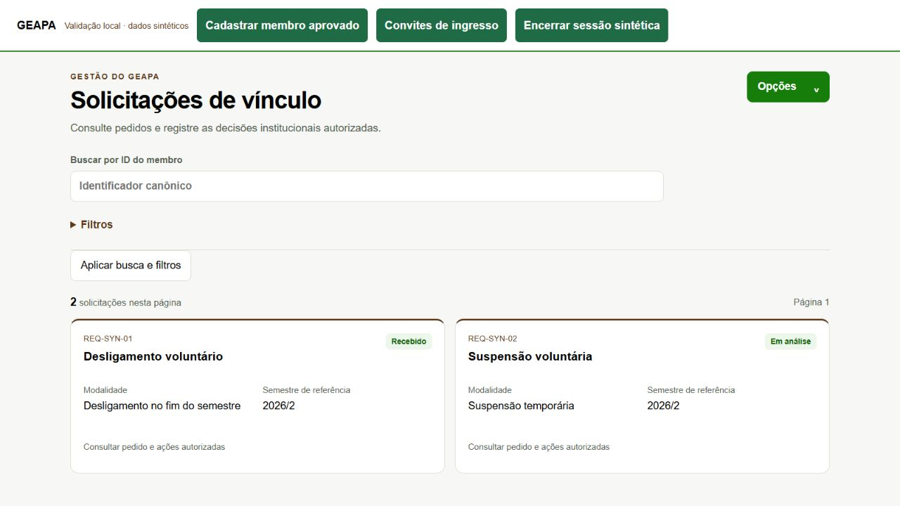
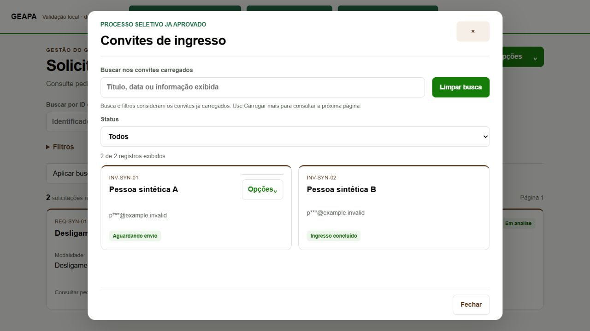
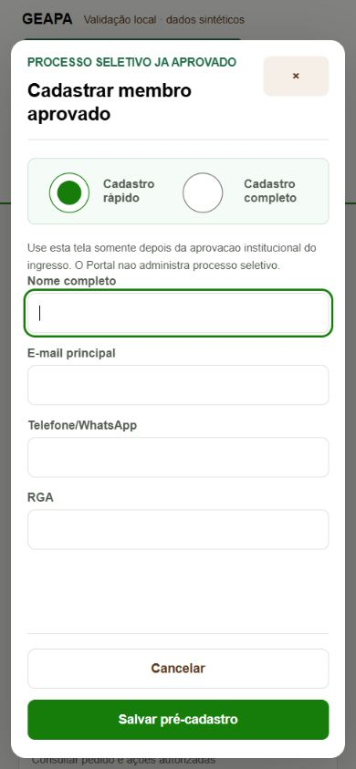

# GEAPA — Solicitações de vínculo e ingresso: Design System

Concluído em 01/11/2026. GO para a publicação visual compatível, já realizada. A publicação não habilita ingresso nem amplia competências.

## Implementação

- Solicitações de vínculo: cabeçalho e menu geral compartilhados, busca por identificador, filtros expansíveis, resumo por página e cards acessíveis por clique/teclado. Paginação e filtros enviados ao leitor original foram preservados.
- Detalhes/análise: modal compartilhado, foco, Escape, proteção de rascunho e bloqueio de envio concorrente. Respostas anteriores à troca de sessão são descartadas. Decisões, modalidades, exigências de ata e payloads permanecem os anteriores.
- Ingresso administrativo: cadastro rápido/completo no modal compartilhado; convites em cards com busca e status sobre os itens carregados. Ações seguem exclusivamente os indicadores já fornecidos pelo leitor. Contatos continuam mascarados.
- Corrigido o link de Solicitações no menu de Membros, que apontava para uma rota inexistente. Destino canônico: `#/admin/membros/solicitacoes-vinculo`.
- Novos renderizadores tipados em `src/components/admin-panels.mts`; reaproveitados tokens, cards, filtros, menu, modais e CSS do Design System. Serviços JavaScript e regras canônicas não foram duplicados.

## Testes

95 testes aprovados, zero falhas. Incluem as oito combinações de ações dos convites, escape de conteúdo, omissão de campos privados, paridade dos payloads rápido/completo, paridade das decisões anteriores, bloqueio de duplo envio, descarte de resposta após troca de sessão e destino correto do menu.

`npm ci`, typecheck, build e reprodução determinística aprovados. As referências de paridade dos novos testes são fixtures locais de código, independentes de histórico Git disponível em checkout raso.

No navegador sintético: desktop e 390 px, cards/teclado, filtro de status, Escape, preservação de rascunho, falha controlada e bloqueio durante envio. Nenhuma chamada externa no simulador. A barra de validação permanece exclusivamente em `tests/visual`, fora do Hosting.

No Portal DEV: sessão restaurada; três solicitações carregadas; detalhe da suspensão sintética terminal consultado; cadastro rápido/completo aberto com o curso oficial Engenharia Agronômica; três convites lidos e filtro de concluídos resultando em dois; link corrigido verificado pela navegação oficial. Nenhum cadastro, convite ou decisão foi enviado.

No Portal PROD: sessão restaurada; gestão de Membros com 14 registros; menu do perfil atual limitado a Atualizar e Correções cadastrais. Solicitações permanece recusada para esse perfil e ingresso permanece oculto. Essas restrições foram preservadas, não contornadas para produzir evidência.

## Publicação e rastreabilidade

| Item | Versão |
|---|---|
| Fonte publicada | `bdecaa6` (implementação `2fbfaa9`) |
| Hosting DEV final | `19603ecb385097aa` |
| Hosting PROD | `312fc053e5ec5084` |
| Function DEV preservada | `geapacommanddevpilot-00060-qix` |
| Function PROD preservada | `geapacommand-00017-vih` |

Seis assets de interface publicados. Hashes servidos conferidos; todos os demais assets e a configuração de Hosting preservados. Nenhuma alteração de Core, policies, capacidades, Auth, Rules, IAM ou dados institucionais; nenhum push.

Backup verificável do Hosting e rotina de rollback com proteção contra publicação posterior preservados em `C:/GEAPA-WORKSPACE/members-admin-design-20261101`. Retorno PROD disponível para `c77f84ff82895fda`; não é necessário restaurar dados ou alterar Functions. Rollback não executado por ausência de falha.

## Capturas

As capturas abaixo usam dados sintéticos. Os registros privados da validação real permanecem fora do repositório.

## Limites

Esta campanha reformula a administração de solicitações, cadastro e convites. O aceite/complementação SELF e suas regras não foram reescritos. Não houve nova homologação de decisões institucionais ou ingresso efetivo em PROD; a disponibilidade continua condicionada aos controles e perfis já aprovados.
