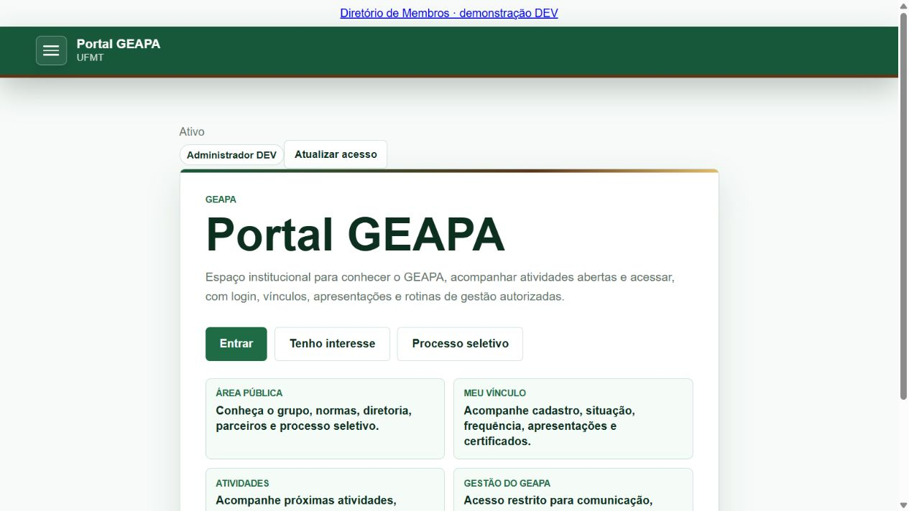
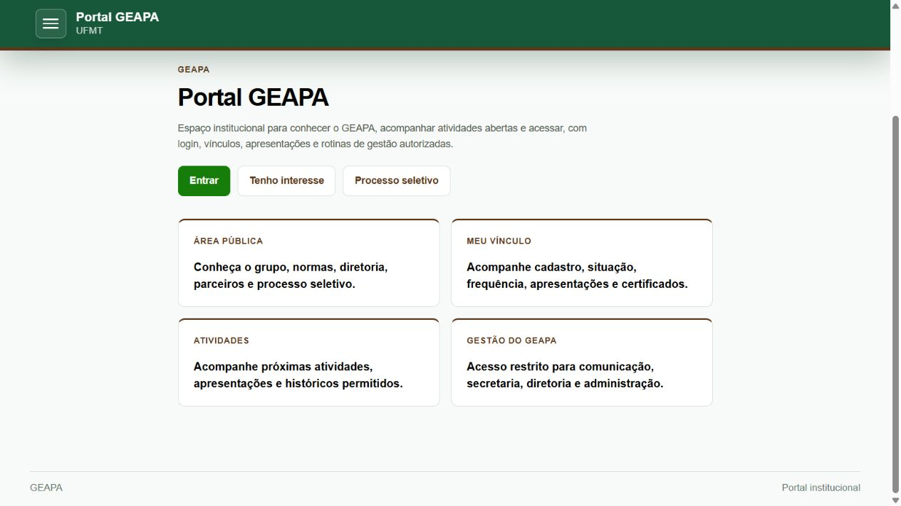
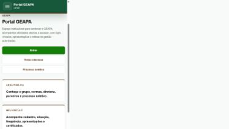
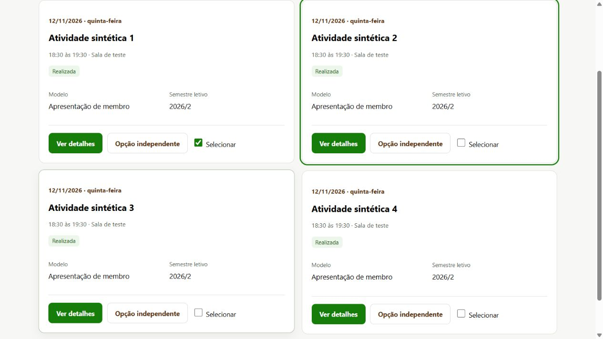
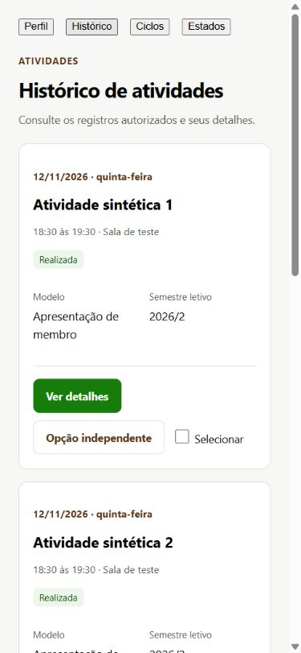
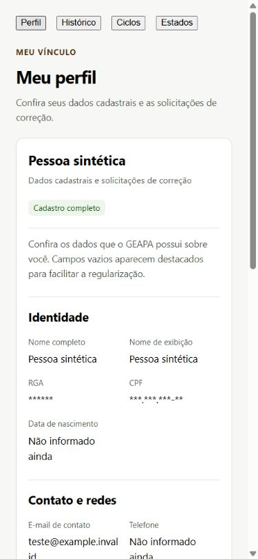

# GEAPA — padronização visual e interação do Portal

Data: 01/11/2026. GO para a publicação compatível de interface, concluída em DEV e PROD. Não é homologação de funcionalidades ainda fechadas nem de decisões institucionais.

## Fonte e publicação

- Repositório oficial: geapaufmt/geapa-portal; checkout preservado portal-admin-design-20261101, branch design/admin-panels-20261101.
- Base publicada reconciliada: checkpoint 7b3ee42, runtime anterior bdecaa6. Origin/main 26f66ba não substituiu a versão moderna.
- Implementação: 16a9a6d; candidata final: 42cf77a. Sem push ou alteração de main.
- DEV final: **3b2122a4b6b4dfce**; PROD final: **10d2116835bcfe0d**.
- Functions preservadas: DEV geapacommanddevpilot-00060-qix; PROD geapacommand-00017-vih.
- Onze assets de interface publicados; hashes em [unified-release.json](design/unified-release.json). Readback dos bytes servidos, configuração Hosting e demais assets aprovado.
- Nenhuma alteração em policies, Rules, Auth, IAM, Storage, Core, rotas de escrita ou dados institucionais. Nenhum comando de negócio enviado.

## Componentes e mudanças

- card-interactions.mts: extração e fortalecimento do comportamento já usado nos ciclos. Instalação única; clique/Enter/Espaço delegam ao controle original. Ignora seleção de texto, modificadores, evento já tratado, tecla repetida, controles internos, conteúdo editável, ações desabilitadas, regiões ocultas e estados ocupados. Minicards não ativam o ciclo externo.
- portal-design.mts: entrada visual disponível antes da autenticação, sem Firebase, provider, leitura ou envio.
- portal-design.css: estilos opt-in para páginas migradas, cards marcados e controles do Design System. Transições de 200 ms, hover apenas em ponteiro fino, toque discreto, foco visível e reduced-motion. Cards informativos não recebem cursor, tabindex ou ação artificial.
- design-system.mts: cards administrativos reutilizam seu botão de detalhe como ação principal. Os modais SELF de correção cadastral e vínculo passam a usar o gerenciamento de foco, Escape, rascunho e fechamento seguro existente.
- Início, entrada, Meu perfil, Minha situação, Minha atuação, ingresso SELF, próximas atividades/histórico e diretório público receberam superfícies e tipografia compartilhadas. Consultas de pendências/status receberam cabeçalho compartilhado, preservando seus bloqueios.
- Frequência permite clique de superfície somente quando já há ação de **consultar** justificativa. Cards com apenas envio/edição continuam informativos.
- Diretório público deixou de declarar incorretamente dados sintéticos DEV em PROD; seu reader e as máscaras não foram alterados.
- Formulários/payloads/catálogos preservados. Na suspensão SELF, resposta tardia após troca de sessão não mostra resultado do usuário anterior; envio pendente impede duplicação e fechamento acidental.
- A navegação de testes existe somente em tests/visual; o manifesto de build não a publica.

## Inventário completo

43 rotas na navegação atual, mais o diretório autônomo /membros.html. Os rótulos “implementado” do registro de rotas não foram confundidos com renderers funcionais: páginas editoriais, avaliação de egresso e painel agregado sem módulo conectado permanecem registradas como pendências. Duas rotas condicionais antigas, Produção científica e Equipe, dependem de PortalPublicData e permanecem placeholders, sem ativação.

| Tela | Rota | Antes | Resultado |
|---|---|---|---|
| Conteúdo Público | `#/admin/conteudo-publico` | Funcionalidade ainda não implementada/conectada no bundle publicado | Preservada; sem implementação nova |
| Início | `#/inicio` | Visual legado | Padronizado nesta campanha |
| Sobre o GEAPA | `#/sobre` | Funcionalidade ainda não implementada/conectada no bundle publicado | Preservada; sem implementação nova |
| História | `#/historia` | Funcionalidade ainda não implementada/conectada no bundle publicado | Preservada; sem implementação nova |
| Diretoria | `#/diretoria` | Funcionalidade ainda não implementada/conectada no bundle publicado | Preservada; sem implementação nova |
| Orientadores | `#/orientadores` | Funcionalidade ainda não implementada/conectada no bundle publicado | Preservada; sem implementação nova |
| Membros | `#/membros` | Funcionalidade ainda não implementada/conectada no bundle publicado | Preservada; sem implementação nova |
| Documentos e normas | `#/documentos` | Funcionalidade ainda não implementada/conectada no bundle publicado | Preservada; sem implementação nova |
| Parceiros | `#/parceiros` | Funcionalidade ainda não implementada/conectada no bundle publicado | Preservada; sem implementação nova |
| Processo seletivo | `#/processo-seletivo` | Funcionalidade ainda não implementada/conectada no bundle publicado | Preservada; sem implementação nova |
| Contato | `#/contato` | Funcionalidade ainda não implementada/conectada no bundle publicado | Preservada; sem implementação nova |
| Avaliação de egresso | `#/avaliacao-egresso` | Funcionalidade ainda não implementada/conectada no bundle publicado | Preservada; sem implementação nova |
| Meu ingresso | `#/ingresso` | Visual legado | Formulário padronizado; sem convite ativo nesta prova |
| Entrar | `#/login` | Visual legado | Padronizado nesta campanha |
| Tenho interesse | `#/interesse` | Funcionalidade ainda não implementada/conectada no bundle publicado | Preservada; sem implementação nova |
| Meu perfil | `#/app/meu-perfil` | Visual legado | Padronizado; leitura PROD comprovada, consulta DEV indisponível |
| Minha situação | `#/app/minha-situacao` | Visual legado | Padronizado nesta campanha |
| Minha frequência | `#/app/frequencia` | Concluído | Concluído; interação compartilhada |
| Minhas apresentações | `#/app/minhas-apresentacoes` | Concluído | Concluído; interação compartilhada |
| Meus certificados | `#/app/certificados` | Funcionalidade ainda não implementada/conectada no bundle publicado | Preservada; sem implementação nova |
| Minhas inscrições | `#/app/inscricoes` | Funcionalidade ainda não implementada/conectada no bundle publicado | Preservada; sem implementação nova |
| Minhas participações | `#/app/participacoes` | Funcionalidade ainda não implementada/conectada no bundle publicado | Preservada; sem implementação nova |
| Preferências de comunicação | `#/app/preferencias` | Funcionalidade ainda não implementada/conectada no bundle publicado | Preservada; sem implementação nova |
| Próximas atividades | `#/atividades` | Parcialmente adaptada | Padronizado nesta campanha |
| Histórico de atividades | `#/agenda/historico-atividades` | Parcialmente adaptada | Padronizado nesta campanha |
| Calendário | `#/agenda/calendario` | Funcionalidade ainda não implementada/conectada no bundle publicado | Preservada; sem implementação nova |
| Painel administrativo | `#/admin` | Funcionalidade ainda não implementada/conectada no bundle publicado | Preservada; sem implementação nova |
| Membros | `#/admin/membros` | Concluído | Concluído; interação compartilhada |
| Correções cadastrais | `#/admin/correcoes-cadastrais` | Concluído | Concluído; interação compartilhada |
| Solicitações de vínculo | `#/admin/membros/solicitacoes-vinculo` | Concluído | Concluído; interação compartilhada |
| Atividades | `#/admin/atividades` | Concluído | Concluído; interação compartilhada |
| Chamadas | `#/admin/chamadas` | Funcionalidade ainda não implementada/conectada no bundle publicado | Preservada; sem implementação nova |
| Justificativas | `#/admin/justificativas` | Concluído | Concluído; interação compartilhada |
| Apresentações | `#/admin/apresentacoes` | Concluído | Concluído; interação compartilhada |
| Comunicação | `#/admin/comunicacao` | Funcionalidade ainda não implementada/conectada no bundle publicado | Preservada; sem implementação nova |
| Processo seletivo | `#/admin/processo-seletivo` | Funcionalidade ainda não implementada/conectada no bundle publicado | Preservada; sem implementação nova |
| Painel da Diretoria | `#/admin/painel-diretoria-v2` | Funcionalidade ainda não implementada/conectada no bundle publicado | Preservada; sem implementação nova |
| Pendências da Diretoria | `#/admin/pendencias-diretoria` | Visual legado | Leitor padronizado; acesso permanece fechado |
| Status do Sistema V2 | `#/admin/status-v2` | Visual legado | Leitor padronizado; acesso permanece fechado |
| Normas e parâmetros | `#/admin/normas-parametros` | Funcionalidade ainda não implementada/conectada no bundle publicado | Preservada; sem implementação nova |
| Configurações | `#/admin/configuracoes` | Funcionalidade ainda não implementada/conectada no bundle publicado | Preservada; sem implementação nova |
| Ciclos e semestres | `#/admin/ciclos-semestres` | Concluído | Concluído; interação compartilhada |
| Minha atuação | `#/app/minha-atuacao` | Visual legado | Padronizado nesta campanha |

Auxiliares preservados: detalhes de atividade/membro, modelos/regras, planejamento/sessões, chamada, materiais, janelas extraordinárias, correções, solicitações e convites administrativos. Os redesigns já homologados foram reutilizados; esta campanha não reexecutou suas decisões. O diretório /membros.html foi padronizado, mas a consulta DEV apresentou indisponibilidade e não foi declarada como leitura bem-sucedida.

## Evidências e testes

- npm ci: instalação limpa, lockfile preservado, zero vulnerabilidades reportadas.
- TypeScript estrito, build DEV/PROD e reprodução por hashes: PASS. 116 assets DEV, 115 PROD.
- **103 testes aprovados, zero falhos**, incluindo as regressões pertinentes anteriores.
- Novas provas: delegação única, elementos aninhados, controles independentes, bloqueio disabled/busy/hidden, seleção/modificadores, Enter/Espaço, tecla repetida, isolamento dos estilos, ausência de providers/handlers de hover, preservação do idempotency key em falha, descarte de resposta após troca de sessão.
- Navegador local: quatro cards sintéticos; clique na superfície; botões e checkbox independentes; Enter/Espaço; Escape e retorno do foco; minicard abre somente seu semestre; estados vazio/carregamento/erro/negado/disabled.
- DEV real: histórico com 60 cards autorizados; filtro por modelo sintético; detalhe da fixture; Membros com 22 resultados sintéticos na busca; abertura por Enter e retorno do foco; Opções da atividade com restrições retornadas pelo Core; Minha atuação e Minha situação; formulário SELF aberto/fechado e rascunho descartado **sem envio**; frequência carregada.
- Mobile: viewport de 390×844, uma coluna no histórico, largura de documento 375 px sem overflow horizontal; não equivale a ensaio em aparelho físico. Reduced-motion verificado no CSS/testes, sem simulação de preferência do sistema operacional.
- PROD: reload com restauração silenciosa Firebase; perfil autorizado renderizado; formulário Corrigir Curso aberto e fechado por Escape, sem alteração/envio; home desktop/mobile; listagem administrativa com 55 atividades. Detalhe histórico de ATV-2026-1-0004 aberto por Enter, conferência preservada e edições comuns bloqueadas. Menu Opções de ATV-2026-2-0024 carregado com realização indisponível por estado/data e sem competência RH adicionada. Minhas apresentações DEV carregou 10 registros na página, preservando materiais/históricos; nenhum arquivo foi enviado.
- A primeira abertura PROD utilizou HTML em cache anterior; reload carregou o entry e as classes novas, confirmado no DOM. Não foi preciso alterar política de cache, login ou CSP.

## Capturas e comparação

Antes: listagem histórica em layout legado, home com tratamento visual anterior, perfil sem a composição atual. Depois: superfícies neutras, hierarquia de texto, duas colunas no desktop/uma no celular e leitura por card sem multiplicar ações.

As imagens versionadas abaixo são sintéticas ou da página inicial sem dados pessoais; capturas autenticadas, antes/depois da home e histórico, e formulários reais ficam fora do Git, em C:/GEAPA-WORKSPACE/portal-unified-design-20261101/captures/.

## Limites e pendências reais

- Meu perfil DEV já respondia “Não foi possível validar estas informações” **antes** da campanha; o erro persistiu. O renderer foi validado com DTO sintético e a leitura autenticada PROD passou. Não foram alterados dados para contornar a falha.
- Ingresso DEV sem convite ativo não concluiu a consulta e mostrou mensagem de recuperação; não foi inventado candidato ou ingresso. A complementação completa não tem nova prova física nesta campanha.
- Diretório público DEV apresentou “temporariamente indisponível”; aparência/erro/recuperação visual conferidos, dados públicos não fabricados.
- Sobre e Pendências da Diretoria continuaram fechadas. Os demais placeholders e bloqueios permanecem fora desta autorização de interface.
- Não foram repetidas ações institucionais, uploads, decisões de RH ou provas de todos os perfis. Os testes anteriores continuam sendo a evidência desses contratos.

## Rollback e rastreabilidade

Rollback exclusivamente de Hosting por versão anterior, condicionado a PROD ainda estar na versão desta campanha; nunca restaurar sobre release posterior. Baseline PROD: 312fc053e5ec5084. Não há rollback de fatos ou snapshots Firestore. O procedimento foi preparado, não disparado artificialmente em PROD.

Evidências privadas: C:/GEAPA-WORKSPACE/portal-unified-design-20261101; snapshots, intenção, release e readback em release-dev/ e release-prod/, script release.cjs. Gates de publicação exigem a prova DEV e preservam os hashes dos assets não relacionados.

**Veredito:** GO para o Design System publicado e para continuidade do desenvolvimento. Não declarar 43 funcionalidades operacionais: o inventário distingue funcionalidades existentes, leitores fechados e placeholders. As falhas de leitura DEV acima precisam de diagnóstico próprio, sem ampliar permissões ou mascarar dados.
